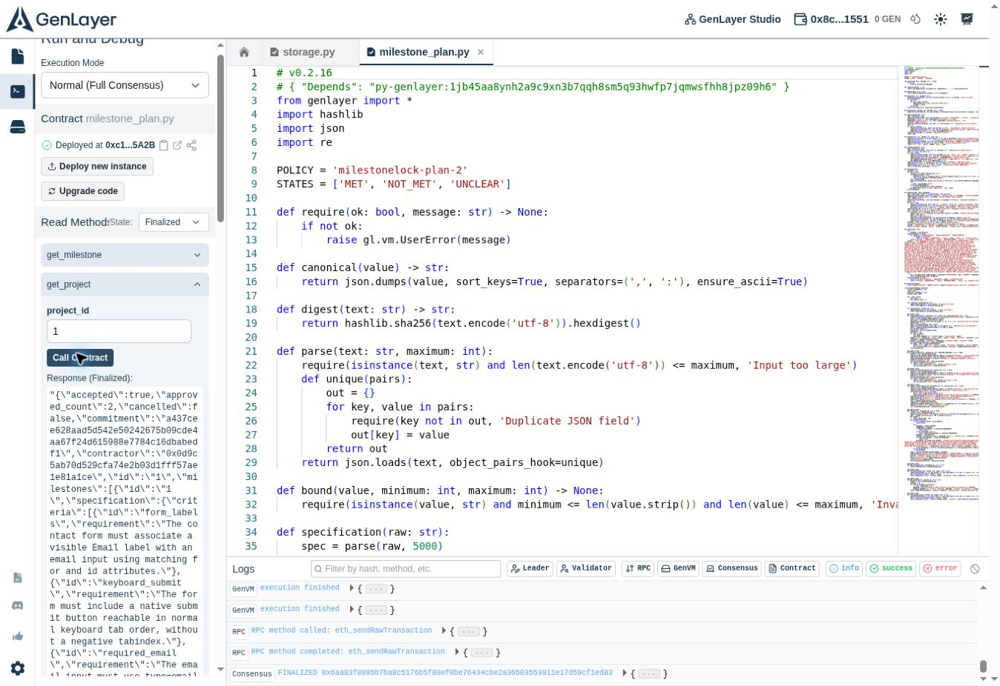

# Milestone submission v1 — project plans and evidence packs

This is the first progress submission after acceptance. The software release is v2; the contribution portal calls the first milestone v1.

Accepted baseline: [`598b954d86fca5fc37b89c6df71258aa03cbfc21`](https://github.com/ANZA24k/MilestoneLock/commit/598b954d86fca5fc37b89c6df71258aa03cbfc21).

## What changed

| Accepted version | New functionality | Why it matters |
| --- | --- | --- |
| Independent standalone milestones | Immutable ordered project plans, 2–6 milestones, one whole-plan commitment and exact contractor acceptance | Parties agree to the complete delivery sequence upfront |
| No cross-milestone gates | Later evidence submissions require the predecessor's recorded approval in contract state | A later deliverable cannot bypass an unapproved earlier step |
| One evidence document per revision | Packs of 1–3 pinned documents: exactly one DELIVERABLE and optional CORROBORATION | Artifact and supporting evidence are assessed together |
| Quotes refer implicitly to one document | Every finding names its source ID; deterministic checks require an exact excerpt in that document | Prevents attributing a quote to the wrong source |
| Generic retry behavior for unavailable sources | Permanent 4xx, invalid UTF-8 and hash/length mismatches become INCONCLUSIVE; transient HTTP/model errors revert without consuming the pending review | Separates invalid evidence from retryable infrastructure failures |
| Standalone receipt verification | Project-plan binding, milestone dependency binding, pack hashes, decision chain and full export | Reviewers can independently verify the delivery sequence and its records |

The original `contracts/milestone_lock.py`, accepted deployment, finalized records and verification script remain available. The new standalone source is `contracts/milestone_plan.py`. No existing contract is upgraded and no prior decisions are relabeled as new progress.

## Deployment and review path

New contract: [0xc1B531B1f8bae23Bb3a942F78Df0ccee45705A2B](https://explorer-studio.genlayer.com/address/0xc1B531B1f8bae23Bb3a942F78Df0ccee45705A2B).

1. Open [Project plans](https://milestonelock.ansaf1st34.chatgpt.site/plans.html). No wallet is required for reading.
2. Select **Synthetic accessible delivery · two-step pilot**. Inspect the whole-plan commitment, contractor acceptance and ordered sequence.
3. Inspect step 1's evidence pack, source-specific excerpts and approval.
4. Select step 2 and inspect its predecessor requirement and append-only rejected/corrected review history.
5. Choose **Verify every source** to fetch and hash all sources in the current pack. Choose **Export complete receipt** for the project plan and selected milestone's complete review history.
6. Open the recorded verification below and rerun `npm run verify:plans`. Check SUCCESS as well as FINALIZED and MAJORITY_AGREE for successful transactions; finalization alone does not prove successful execution. The intentionally blocked submission is classified separately.

The website prepares `create_project`, `accept_project`, `cancel_unaccepted_project`, `submit_evidence_pack` and `review` calls. Actual writes use GenLayer Studio's built-in accounts with Normal (Full Consensus), simulation disabled. No wallet keys are exported; no MetaMask extension is required.

## Evidence

- [Exact complete pack](../examples/completed-pack.json) and [contradictory pack](../examples/incomplete-pack.json), pinned to the source commit.
- [Deployment manifest](../plan-deployment.json): exact source hash, accounts and transaction hashes.
- [Recorded finalized state, consensus summaries and byte verification](evidence/plan-live-state.json).
- [Contract tests](../tests/test_milestone_plan.py): dependency release/blocking, whole-plan commitment, roles, exact acceptance, cancellation, pack/schema/size guards, source error classification, source-quote binding, validator disagreement, revisions and immutable history.
- [Frontend tests](../tests/web.test.mjs): full-plan receipt verification, tampered dependency/spec/history rejection and exact UTF-8 source preparation, alongside the original regression tests.
- [CI runs](https://github.com/ANZA24k/MilestoneLock/actions): both contracts are tested and checked by GenLayer's linter.

## Scope and limits

This is a Studionet evidence-decision pilot, with synthetic documents and test reference amounts. Approval does not transfer funds, escrow money or prove off-document delivery. The static corroboration report is a submitted claim; its role is not an authenticity guarantee. The negative pilot intentionally pairs contradictory HTML with a positive supporting report to test primary-artifact precedence. Validators still perform model-based judgment, and uncertainty blocks approval.

Contract-level bounds: 2–6 milestones per project; 1–6 criteria per milestone; 1–3 sources; exactly one DELIVERABLE; at most 30,000 bytes per source and 60,000 per pack; commit-pinned raw GitHub UTF-8 `.txt` documents only; maximum three revisions; approvals terminal. Plans are linear rather than arbitrary graphs. Specification and evidence rules cannot be amended after creation. A contractor can decline an unaccepted plan; its sponsor can cancel it before acceptance.

Automated tests and public HTTP/RPC checks do not establish visual or real MetaMask-extension QA. This environment has no supported Sites preview browser; visual browser QA of the website is not claimed.

## Copy-ready submission

Title: Project plans, dependency gates and multi-document evidence

Added a new MilestonePlan Intelligent Contract that locks 2–6 ordered milestones under one accepted project commitment. Later submissions are blocked until their predecessor is approved. Evidence revisions support 1–3 commit-pinned documents with independent retrieval, hash checks and source-bound excerpts. Added a public project-plan workspace, evidence-pack builder, progress tracking, source verification and exportable receipts. Improved permanent versus transient source-failure handling. A live Studionet pilot proves blocked early submission, first-step approval, and second-step rejection followed by corrected approval with history preserved. All 73 tests pass; both contracts pass GenLayer lint. The accepted deployment remains available. Synthetic pilot only; no funds transferred.

Evidence: this release document, the baseline-to-current GitHub comparison, the public project-plan workspace, and `docs/evidence/plan-live-state.json`. Choose the portal change type corresponding to new features or contract functionality.

